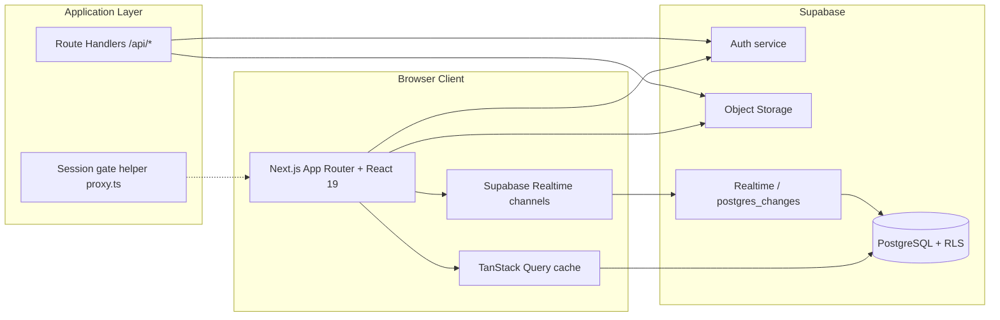

# Innr — Campus Social Platform

[](https://www.typescriptlang.org/)
[](https://nextjs.org/)
[](https://react.dev/)
[](https://supabase.com/)
[](https://vitest.dev/)

Private production-style monolith for university-scoped social feeds, events, and media — designed around **typed APIs**, **durable Postgres state**, **real-time invalidation**, and **resilient object uploads**.

---

## Short Technical Overview

Innr is a **full-stack TypeScript application** (Next.js App Router) backed by **Supabase** (PostgreSQL, Row Level Security, Auth, Storage, realtime). The product surface is campus social: posts, threaded engagement, events with calendar UX, notifications, and profile-centric identity — but the engineering emphasis is on **end-to-end data flow**, **secure session handling**, **media pipelines**, **client cache coherence under concurrency**, and **test-backed API boundaries** suitable for operating at real user scale.

---

## Key Features

| Area | Engineering notes |
|------|-------------------|
| **Feeds & engagement** | Post CRUD, likes, comments, reposts, bookmarks; optimistic UI with centralized React Query invalidation |
| **Events** | Creation, editing, recurrence utilities, attendance; calendar-driven discovery |
| **Identity & profiles** | Avatars, profile editing, university-scoped tenancy in the data model |
| **Notifications** | Unread tracking with query-driven client state |
| **Media** | Client-side compression (web worker), direct and **resumable (TUS)** uploads to object storage, public URL derivation |
| **Auth** | Supabase Auth with **HTTP-only cookie** bridge for server-visible sessions; password reset flows |
| **Admin / roles** | Role-gated capabilities for content operations |
| **UX systems** | Dark/light theming, responsive layout, Next.js Image pipeline (AVIF/WebP, remote patterns, cache TTL) |

---

## System Architecture



- **Presentation**: Server and client components under `app/`; shared UI in `components/`.
- **Data access**: Supabase client for CRUD; React Query for normalized server state, staleness, and invalidation.
- **Realtime**: Postgres `UPDATE` subscriptions (e.g. profile channel) drive cache invalidation and local persistence helpers.
- **API surface**: Next.js **Route Handlers** for privileged operations (signed upload minting, cookie bridging) — keeps **service role** keys off the client.

---

## AI / ML Components

This repository is **not** a hosted RAG or LLM product; it is a **high-signal backend + realtime + rich media** foundation that maps cleanly to common **Applied AI / ML Engineering** extensions:

- **Semantic retrieval**: Post and event text + metadata are natural candidates for **embedding pipelines** (batch + near-real-time), **vector indexes** (e.g. pgvector on Postgres), and hybrid **lexical + vector** search APIs.
- **Ranking & personalization**: Feed generation can evolve from chronological queries to **learned ranking** or **two-tower** retrieval with feature logging from existing engagement events.
- **Safety & trust**: Comment and media flows can integrate **classifier or LLM moderation** behind async workers, with Supabase as the system of record and a queue for inference.
- **Evaluation**: Structured event and engagement tables support offline **dataset export** and A/B-style analysis once inference is added.

Stated plainly: **the current codebase demonstrates production-adjacent data, auth, and delivery patterns that AI features typically sit on top of** — not an ML training repo.

---

## Tech Stack

| Layer | Choices |
|-------|---------|
| **Framework** | Next.js 16 (App Router), React 19, TypeScript 5 |
| **Styling** | Tailwind CSS 4, Geist font |
| **Data & auth** | Supabase JS v2, `@supabase/ssr` patterns where applicable |
| **Client state** | TanStack Query v5 |
| **Media** | `browser-image-compression` (web worker), `tus-js-client` (resumable uploads per Supabase constraints) |
| **Quality** | ESLint (Next config), Vitest, Testing Library, MSW |

---

## Backend Infrastructure

- **Database**: PostgreSQL via Supabase; **RLS** as the primary authorization boundary for multi-tenant campus data.
- **Authentication**: Supabase Auth; **token bridge** to **HTTP-only** cookies for server-side session visibility and hardened XSS posture.
- **Object storage**: Bucket-based media with **signed upload URL** minting via a Route Handler using the **service role** (never shipped to the browser).
- **Realtime**: Supabase channels subscribed to `postgres_changes` for targeted invalidation (minimizing stale profile/avatar state).
- **Operational scripts**: `npm run seed:events` — service-role-aware seeding for local/staging datasets (see `scripts/seed-events.ts`).

**Environment variables (representative)**

| Variable | Role |
|----------|------|
| `NEXT_PUBLIC_SUPABASE_URL` | Project URL (client + server) |
| `NEXT_PUBLIC_SUPABASE_ANON_KEY` | Public anon key (client) |
| `SUPABASE_SERVICE_ROLE_KEY` | **Server only** — signed uploads, automation, seeds |

---

## Deployment Details

- **Target platform**: [Vercel](https://vercel.com/) (or any Node host for Next.js 16) with environment variables configured per environment (preview vs production).
- **Supabase**: Hosted project with Storage buckets, Auth redirect URLs, and RLS policies aligned to deployment origins.
- **Media CDN**: Supabase Storage + Next/Image remote patterns for `*.supabase.co` public objects; responsive `srcset` via configured `deviceSizes` / `imageSizes`.
- **CI (recommended)**: Run `npm run lint`, `npm run test`, and `npm run build` on every PR — not yet declared in-repo; see *Future Improvements*.

---

## Challenges and Engineering Decisions

1. **Session model**: Browser client uses Supabase Auth while the server needs a **durable, httpOnly cookie** contract for gated routes and future SSR data fetching — implemented via explicit **set/clear cookie** API routes instead of ad hoc localStorage-only auth.
2. **Upload reliability**: Large files and video exceed simple multipart thresholds; the client switches to **TUS resumable uploads** with chunked retry backoff, matching Supabase’s operational guidance, while smaller payloads use direct storage PUT for lower latency.
3. **Bandwidth & cost**: Images over a size threshold are **compressed client-side** (web worker) before upload to reduce bytes on the wire and storage footprint.
4. **Cache correctness**: Centralized **invalidation helpers** pair with React Query so likes, comments, events, and profile updates do not leave sibling routes stale — covered by **concurrent interaction tests**.
5. **Defense in depth**: `proxy.ts` encodes **allowlisted public routes**, **httpOnly session detection**, and **sanitized `next` redirects** to reduce open-redirect risk (unit-tested); wire as Next.js `middleware` at the repo root when enabling edge enforcement.

---

## Performance or Scalability Improvements

- **Image delivery**: AVIF/WebP negotiation via Next/Image; `minimumCacheTTL` and explicit size breakpoints to limit over-fetching on mobile.
- **Client compression**: Reduces average object size before storage write — fewer gigabytes transferred at scale.
- **Resumable uploads**: Fewer failed end-user uploads on poor campus Wi‑Fi; less support load and re-upload churn.
- **Targeted realtime**: Subscriptions scoped by `userId` / table filters to avoid broadcast fan-out of full table feeds.
- **Query key design**: Namespaced keys (`posts`, `events`, `profile`, `avatar`) to enable surgical invalidation instead of global refetch storms.

**How this grows with users**: Postgres and Supabase scale vertically and via read replicas; hot feeds can move to **materialized views**, **cursor pagination**, or **edge-cached read models**; media can shift to **signed CDN URLs** with short TTLs; write-heavy engagement can be **partitioned by university** or sharded by tenant when single-region Postgres becomes the bottleneck.

---

## Future Improvements

- **Middleware wiring**: Promote `proxy.ts` to `middleware.ts` for edge-enforced auth on every request.
- **Observability**: OpenTelemetry or structured logging for API handlers and upload failures; Sentry (or similar) for client and server.
- **Rate limiting**: Token bucket or edge rate limits on auth and signed-upload routes.
- **AI layer**: Embeddings ingestion job, pgvector, and a `/api/search` semantic endpoint; optional queue (Supabase functions, Cloud Tasks, SQS) for async inference.
- **E2E tests**: Playwright against preview deployments for critical flows (post + media + event RSVP).
- **OpenAPI / typed clients**: Document Route Handlers and generate clients for mobile or BFF consumers.

---

## Screenshots / Demo

> Add 2–4 screenshots (feed, event calendar, post composer with media, notifications) or a 30–60s Loom/GIF hosted in-repo under `docs/` or linked from Releases.

**Suggested captions for recruiters**

1. **Feed + engagement** — optimistic interactions with consistent cache invalidation  
2. **Events** — calendar UX atop normalized event rows  
3. **Media pipeline** — compression + resumable upload path  
4. **Profile + realtime** — avatar updates propagating without manual refresh  

---

## Installation Instructions

**Prerequisites**: Node.js 18+, a Supabase project (Auth, Storage bucket e.g. `post-media`, RLS policies), and optionally Vercel for deployment.

```bash
git clone <your-repo-url>
cd my-app
npm install
```

Create `.env.local`:

```env
NEXT_PUBLIC_SUPABASE_URL=https://<project-ref>.supabase.co
NEXT_PUBLIC_SUPABASE_ANON_KEY=<anon-key>
SUPABASE_SERVICE_ROLE_KEY=<service-role-key>   # server-only; required for signed uploads + seeds
```

```bash
npm run dev          # http://localhost:3000
npm run seed:events  # optional: seed events (service role)
npm run test         # Vitest suite
npm run build        # production compile
```

---

## API or System Flow Overview

| Endpoint / flow | Responsibility |
|-----------------|----------------|
| `POST /api/auth/setCookie` | Accepts access/refresh tokens; sets **httpOnly**, `SameSite=Lax`, production-`Secure` cookies |
| `POST /api/auth/clearCookie` | Clears session cookies on sign-out |
| `POST /api/signed-upload` | Validates bucket; returns **signed upload URL** + path via **service role** |
| **Client → Supabase** | CRUD on Postgres, Storage uploads (direct or TUS), Auth session refresh |
| **Realtime** | `postgres_changes` on `profiles` → React Query invalidation + `localStorage` profile cache update |

**Typical media post flow**

1. Authenticated client creates/uses post row identifiers.  
2. Small images: compress if needed → Storage `upload`. Large/video: **TUS** session with chunked retries.  
3. Optionally: server-minted signed URL path for restricted buckets.  
4. Persist `post_media` metadata; render via Next/Image remote URL.

---

## Resume-Style Impact Summary

- **Architected** a TypeScript full-stack campus social platform on **Next.js 16** and **Supabase**, separating **public anon** and **service-role** concerns for storage and automation.  
- **Implemented** a **dual-path media pipeline** (client compression, direct upload, and **TUS resumable** uploads) to improve reliability for large assets on variable networks.  
- **Designed** session handling around **HTTP-only cookies** and explicit API bridges instead of purely client-side token storage.  
- **Shipped** **realtime-driven cache coherence** (Postgres changes → React Query invalidation) to keep profile and avatar state consistent across routes.  
- **Established** automated quality gates with **Vitest**, **Testing Library**, and **MSW**, including **concurrent interaction** and **cache consistency** coverage.  
- **Production-ready positioning**: environment separation, CDN-friendly image config, and a clear path to **semantic search**, **ranking**, and **inference workers** on the existing data plane.

---

## Suggested Additions (Repo & Recruiting)

**Sections you may still want**

- **Security model** — short RLS policy narrative (what rows users can read/write)  
- **Data model ER diagram** — `profiles`, `posts`, `events`, `post_media`, etc.  
- **Threat model one-pager** — cookie theft, upload abuse, rate limits  
- **Contributing / CODEOWNERS** — if you open-source a slice  

**Badges (optional)**

- Build status: GitHub Actions shield  
- License: if you ever open a subset, add the SPDX badge  

**Repo organization**

- Move app to repo root or rename `my-app` → `apps/web` if you add workers later  
- Add `.github/workflows/ci.yml` running lint, test, build  
- Add `docs/architecture.md` with sequence diagrams for upload and auth  
- Pin **Supabase migrations** in-repo (`supabase/migrations`) for reproducible schema reviews  

**Stronger signal for AI / new-grad loops**

- One **minimal RAG or embedding demo** (even read-only) on your own posts table  
- Published **latency / cost** numbers for embedding batch jobs  
- **Evaluation notebook** (precision@k on search) in `experiments/`  
- **Feature logging** schema for future ranking models  

---

**Author:** Gerald Shimo · **License:** Private — All rights reserved
